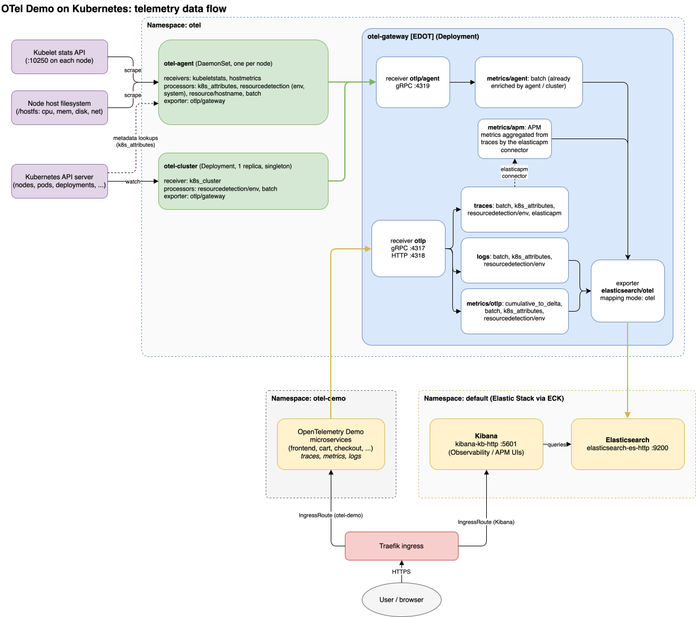

# OTel Observability Demo

## Usage

To get started you need to have a Kubernetes cluster running to run all the applications defined. To start the applications you can run:

```bash
make all
```

Go to the following sites in your browser:

- Kibana instance
    - https://localhost
- OTel application
    - https://otel.localhost

You can login with `training` user and `nonprodpwd` password

## Architecture


